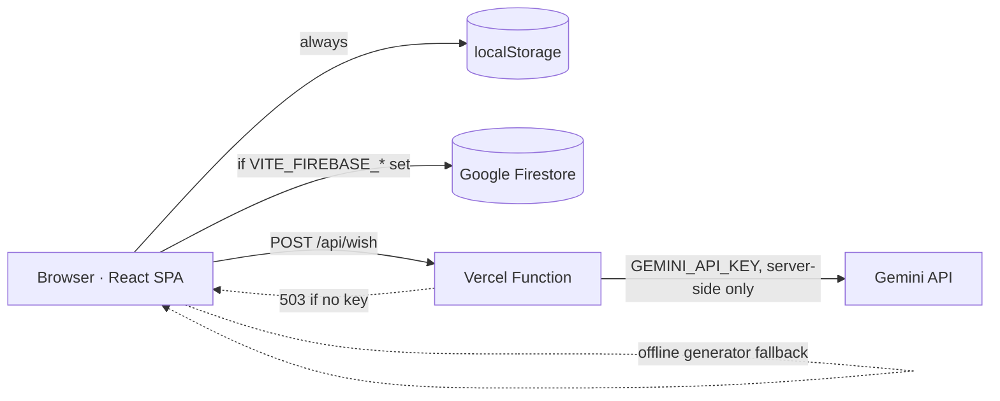

# DIYAverse — The Living Festival of Lights

> **One Light. One Wish. One Connected World.**

An interactive Diwali experience: light a personal diya with a wish, write a greeting in English, Hindi or Bengali, draw a symmetrical rangoli, and watch every community light join one growing mandala.

Built for *Diwali Digital Diya 2026*. It is an independent student project and is **not affiliated with or endorsed by Google, AWS or GDG**.

## 1. Problem
Most festival websites are static greetings. People look at them; they do not take part.

## 2. Solution
DIYAverse makes visitors participants. Each light they add becomes a point in a shared installation, the **Infinity of Light**.

## 3. What makes it different
- **Infinity of Light**: a zoomable golden-angle spiral mandala where every real diya is a light you can hover, tap or reach by keyboard.
- **Radical honesty**: no fake stats, no fake community, no fake "AI". Cloud status, AI source and sample data are always labelled truthfully.
- **Works with zero setup**: Firebase and Gemini are optional. Everything else runs offline in the browser.

## 4. Features
| Area | Details |
|---|---|
| Home | Skippable intro, living diya, particles, reduced-motion aware |
| Light Your Diya | 4 designs, 5 flame colours, ignite animation, sound toggle, personal collection, PNG card, share |
| Wish Studio | 6 tones, 3 languages, 3 lengths, 6 relationships, editable text, 3 card themes, PNG, Web Share with clipboard fallback |
| Rangoli Studio | Live 4–16 fold symmetry, mirroring, freehand + 6 motif stamps, 4 templates, undo/redo (Ctrl+Z / Ctrl+Y), PNG, touch support |
| World of Lights | Shared wall, search, colour filter, sort, pagination, loading/empty/error states, validation, rate limit |
| Infinity of Light | Canvas mandala, zoom/pan/pinch, hover + click story, colour filter, keyboard navigation |
| Festival Night | Fireworks, lanterns, synthesised music + ambience (off by default), full screen |
| Impact | Counts computed from real data only; clearly labelled local vs shared |

## 5. Stack
React 19 · Vite · TypeScript · Tailwind CSS 4 · Framer Motion · Lucide · HTML5 Canvas · React Router · Firebase Firestore (optional) · Gemini API (optional, server-side) · Vercel.

## 6. Architecture

- `DiyaContext` is the single data layer. The UI shows **"Firestore connected"** only after a real *server* snapshot (not cache). Otherwise it shows *Local demo mode* or an error state.
- When Firestore is not live, wall entries are marked **Local only**.
- `/api/wish` returns `503` without a key; the UI then uses the offline generator and labels the result "Written by offline generator (no AI)".

### Why Google and not AWS?
One working, honest integration beats two decorative ones. Firestore's real-time listeners fit a live wall, and Gemini fits the greeting generator. An AWS path (Lambda + DynamoDB behind API Gateway) would be a reasonable future replacement for the data layer behind `src/lib/firebase.ts`, but it was not built and nothing here claims otherwise.

## 7. Folder structure
```
api/wish.ts            Gemini serverless endpoint (optional)
firestore.rules        Security rules for the shared wall
src/components/        Diya, ParticleField, InfinityCanvas, Layout, Toast, CloudBadge…
src/pages/             Home, LightDiya, WishStudio, RangoliStudio, World, Infinity, FestivalNight, Impact, About, NotFound
src/lib/               DiyaContext, firebase, wishes, rangoli, cards, audio, sanitize, share…
```

## 8. Run locally (Windows PowerShell)
```powershell
node -v            # needs v20 or newer
npm install        # install dependencies
npm run dev        # http://localhost:5173
```
Other scripts: `npm run typecheck`, `npm run lint`, `npm run build`, `npm run preview`.
Note: `npm run dev` does not serve `/api/wish`. The app falls back to the offline generator. To test the function locally use `npx vercel dev`.

## 9. Environment variables
See [`.env.example`](.env.example). All optional. Firebase `VITE_*` values are public identifiers by design (security comes from `firestore.rules`). **`GEMINI_API_KEY` must never have a `VITE_` prefix.**

## 10. Setup guides
[FIREBASE_SETUP.md](FIREBASE_SETUP.md) · [DEPLOYMENT.md](DEPLOYMENT.md) · [TESTING.md](TESTING.md) · [PROJECT_PITCH.md](PROJECT_PITCH.md)

## 11. Security notes
- All user text is rendered through React (escaped). Input is trimmed, length-limited, and stripped of control characters and angle brackets.
- Links and a basic blocklist are rejected client-side. **This is a courtesy filter, not real moderation.** Firestore rules enforce shape and size but cannot judge content. For a public launch, add review/reporting.
- Rules allow public create-only writes with strict field validation and server timestamps; no updates or deletes.
- Open public writes can be spammed. The client has a 20 s cooldown, which a determined attacker can bypass. App Check or a moderated function would be the next step.
- Free-tier Gemini content may be used by Google to improve its products; do not enter private data.

## 12. Known limitations
- Hindi/Bengali offline greetings are template-based and were checked for grammar and formality agreement, but should be reviewed by a native speaker before relying on them.
- Greeting-card export needs the web fonts to load; offline it falls back to system fonts.
- The Infinity of Light is tuned for a few thousand lights; the wall loads the latest 300.
- Firestore's free quota is daily and finite; heavy traffic could exhaust it.

## 13. Future improvements
Moderation queue, App Check, shareable deep links to a single light, region map, PWA/offline install, native-speaker-reviewed language packs, AWS adapter.

## 14. Credits and licences
Code: yours to license (add a LICENSE file, e.g. MIT). Fonts: Cormorant Garamond, Plus Jakarta Sans, Hind, Noto Sans Bengali (SIL OFL, via Google Fonts). Icons: Lucide (ISC). All audio is synthesised in-browser; all artwork is original SVG/Canvas.
